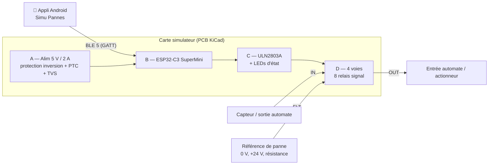
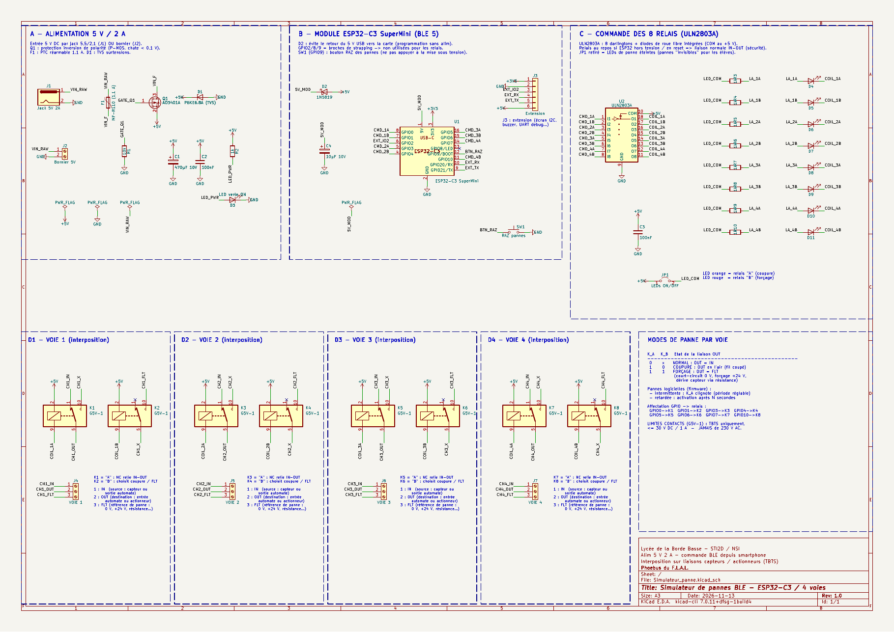

<div align="center">

# 🔧 Simulateur de pannes BLE

**Carte d'interposition 4 voies pilotée par smartphone pour provoquer des pannes réalistes sur un système automatisé didactique, sans toucher au câblage.**

[](Hardware_KiCad/)
[](Logiciel/Firmware/)
[](#-protocole-ble)
[](Logiciel/SimuPannes.apk)
[](Logiciel/Firmware/bin/)
[](Logiciel/Firmware/tests/test_core.cpp)
[](#-nomenclature-et-coût)
[](#-usages-pédagogiques)

[Principe](#-principe) •
[Démarrage rapide](#-démarrage-rapide) •
[Matériel](#-matériel) •
[Firmware](#-firmware-esp32-c3) •
[Application](#-application-android-simu-pannes) •
[Protocole BLE](#-protocole-ble) •
[Sécurité](#%EF%B8%8F-sécurité--limites-dutilisation)

</div>

---

## 🎯 Pourquoi ce projet ?

En TP de maintenance, l'enseignant doit souvent débrancher un fil ou forcer une entrée **devant les élèves** pour créer une panne. Ce simulateur se place **une fois pour toutes** sur les liaisons *capteur → automate* ou *automate → actionneur*. Ensuite, depuis une tablette ou un téléphone, l'enseignant déclenche à distance :

- ✂️ un **fil coupé** (capteur débranché, actionneur non commandé),
- ⚡ un **forçage / court-circuit** (entrée bloquée à 0 ou à 1, dérive via résistance),
- 🎲 une panne **intermittente** (faux contact aléatoire).

Les élèves diagnostiquent avec leurs outils habituels (multimètre, mode visualisation de l'automate…). Un cavalier permet d'**éteindre les LEDs** de la carte pour que les pannes restent invisibles.

## ✨ Fonctionnalités

| | |
|---|---|
| 🔌 **4 voies d'interposition** | 2 relais de signal par voie, borniers à vis 3 points (IN / OUT / FLT) |
| 📱 **Pilotage BLE multi-boîtiers** | Une seule application gère tous les simulateurs de l'atelier en même temps |
| 🛡️ **Sécurité intrinsèque** | Relais au repos = liaison normale. Si l'ESP32 plante ou perd l'alimentation, le système fonctionne normalement |
| 🏷️ **Configuration dans le boîtier** | Nom, emplacement, identifiants (`%I0.2`, `%Q0.4`) et libellés des voies stockés en flash : un 2ᵉ téléphone retrouve la même configuration |
| 🔐 **Code PIN** | Empêche une autre application BLE (celle d'un élève…) de déclencher des pannes |
| 🔴 **Bouton RAZ** | Appui court : toutes les voies à l'état normal. Appui 8 s : PIN remis à `0000` |
| 🧪 **Mode démo** | L'interface s'ouvre dans Chrome sur PC avec 3 simulateurs fictifs, sans matériel |
| 💶 **Faible coût** | ≈ 28 € TTC port compris pour une carte (relevé du 15/11/2026) |

---

## 🧭 Principe

### Architecture du système



### Une voie d'interposition = 2 relais

```
              K_A (repos)                    Bornier J4..J7
 IN  o────────NC ┐                           1 : IN  = côté source
                 COM ───────────── o OUT      (capteur ou sortie automate)
           ┌──NO ┘                           2 : OUT = côté destination
           │ (nœud X)                         (entrée automate ou actionneur)
           └── COM K_B ── NC : en l'air      3 : FLT = référence de panne
                       └─ NO ──────── o FLT   (0 V, +24 V, résistance…)
```

| Mode | Relais A | Relais B | Effet sur OUT |
|---|:-:|:-:|---|
| **0 — Normal** | 0 | 0 | OUT = IN |
| **1 — Coupure** | 1 | 0 | OUT en l'air (fil coupé) |
| **2 — Forçage** | 1 | 1 | OUT = FLT |
| **3 — Coupure ~** | aléatoire | 0 | faux contact (0,1 s → période réglée) |
| **4 — Forçage ~** | aléatoire | 1 | forçage intermittent |

> [!NOTE]
> Ordre de commutation garanti par le firmware : **B se ferme avant A** et **A s'ouvre avant B**, pour qu'OUT ne passe jamais par un état « en l'air » parasite. Au démarrage, toutes les voies sont à l'état normal : les pannes ne sont **pas** mémorisées après une coupure d'alimentation.

---

## 🚀 Démarrage rapide

1. **Fabriquer la carte** : envoyer `Hardware_KiCad/production/Simulateur_panne.zip` (Gerber) chez un fabricant de PCB, puis souder les composants (tous traversants sauf Q1 en SOT-23).
2. **Flasher l'ESP32-C3** sans installer d'outil : ouvrir [esptool-js](https://espressif.github.io/esptool-js/) dans Chrome ou Edge, puis flasher `Logiciel/Firmware/bin/SimPanne_ESP32C3_v1.0.0_merged.bin` à l'adresse **`0x0`**.
3. **Installer l'application** : copier `Logiciel/SimuPannes.apk` sur la tablette, l'ouvrir et autoriser l'installation.
4. **Mettre en service** : alimenter le boîtier (LED à 2 Hz), appuyer sur **＋** dans l'appli, choisir `SP-NEW-xxxx`, PIN `0000`, puis configurer nom et voies.
5. **Câbler une voie** : IN = côté source, OUT = côté destination, FLT = référence de panne voulue.

> [!TIP]
> Pour présenter l'outil sans matériel, ouvrez simplement [`Logiciel/Android/app/src/main/assets/index.html`](Logiciel/Android/app/src/main/assets/index.html) dans Chrome : le mode démo simule 3 boîtiers.

---

## 📁 Organisation du dépôt

```
Simulateur_panne/
├── Hardware_KiCad/                     ← carte électronique (KiCad 7 / 8 / 9)
│   ├── Simulateur_panne.kicad_pro      projet à ouvrir
│   ├── Simulateur_panne.kicad_sch      schéma A3
│   ├── Simulateur_panne.kicad_pcb      circuit imprimé routé
│   ├── Simulateur_panne.kicad_sym      symbole ESP32-C3 SuperMini
│   ├── Simulateur_panne.pretty/        empreinte ESP32-C3 SuperMini (sur support)
│   ├── exports/                        schéma PDF/PNG + nomenclature CSV
│   ├── production/                     Gerber, BOM et positions JLCPCB
│   └── README.md                       documentation matérielle détaillée
├── Logiciel/
│   ├── SimuPannes.apk                  application Android prête à installer
│   ├── Firmware/
│   │   ├── SimPanne_ESP32C3/           sketch Arduino (.ino + SimCore.h/.cpp)
│   │   ├── bin/                        firmware compilé (merged, adresse 0x0)
│   │   └── tests/test_core.cpp         tests unitaires du cœur (sur PC)
│   ├── Android/                        sources de l'appli (HTML/JS + Java)
│   └── README.md                       documentation logicielle détaillée
├── Nomenclature chiffrée — Simulateur de pannes.xlsx
└── qr.png                              QR code vers ce dépôt (sérigraphié sur le PCB)
```

---

## 🔩 Matériel

<p align="center">
  <a href="Hardware_KiCad/exports/Schema_Simulateur_panne.pdf">
    
  </a>
  <br><em>Schéma complet (cliquer pour la version PDF)</em>
</p>

| Bloc | Rôle | Composants clés |
|---|---|---|
| **A — Alimentation** | 5 V / 2 A par jack 5,5×2,1 ou bornier | Q1 AO3401A (anti-inversion, chute < 0,1 V), F1 PTC 1,1 A, D1 TVS P6KE6.8A |
| **B — Microcontrôleur** | BLE 5, USB-C, 3,3 V intégré | ESP32-C3 SuperMini **sur support** (remplaçable), D2 1N5819, SW1 RAZ, J3 extension (I2C/UART) |
| **C — Commande relais** | 8 darlingtons avec roue libre intégrée | ULN2803A, 8 LEDs (orange = coupure, rouge = forçage), JP1 = LEDs ON/OFF |
| **D — 4 voies** | Interposition sur les liaisons | 8 relais signal 5 V, 4 borniers 3 points |

### Affectation des GPIO

| GPIO | 0 | 1 | 3 | 4 | 5 | 6 | 7 | 10 | 8 | 9 |
|---|---|---|---|---|---|---|---|---|---|---|
| **Rôle** | K1 V1-A | K2 V1-B | K3 V2-A | K4 V2-B | K5 V3-A | K6 V3-B | K7 V4-A | K8 V4-B | LED module | Bouton RAZ |

> [!IMPORTANT]
> GPIO2, GPIO8 et GPIO9 sont des **broches de strapping** : elles ne pilotent volontairement aucun relais, sinon le ULN2803A bloquerait le démarrage de l'ESP32.

### Consommation (sous 5 V)

| Poste | Courant |
|---|---|
| 8 bobines de relais (cas extrême) | 240 mA |
| 9 LEDs | 25 mA |
| ESP32-C3 en émission BLE (pic) | ≈ 350 mA |
| Extension J3 (réserve) | 200 mA |
| **Total maxi** | **≈ 0,8 A** → bloc secteur 2 A largement dimensionné |

Détails complets (justification des choix, exemples de raccordement, points de vigilance) : **[Hardware_KiCad/README.md](Hardware_KiCad/README.md)**.

---

## 💾 Firmware ESP32-C3

### Option 1 — Binaire précompilé (recommandé)
Flasher `Logiciel/Firmware/bin/SimPanne_ESP32C3_v1.0.0_merged.bin` à l'adresse **`0x0`** avec [esptool-js](https://espressif.github.io/esptool-js/) (Chrome / Edge + câble USB-C).

### Option 2 — Compilation avec Arduino IDE 2

| Élément | Version testée |
|---|---|
| Carte : *esp32 by Espressif* | 3.3.12 |
| Bibliothèque : *NimBLE-Arduino* (h2zero) | 2.5.2 |
| Type de carte | `ESP32C3 Dev Module` |
| Option | `USB CDC On Boot : Enabled` |

Ouvrir `SimPanne_ESP32C3.ino` puis téléverser. En cas d'échec : maintenir **BOOT**, appuyer sur **RESET**, relâcher BOOT.

### Signification de la LED du module

| Clignotement | État |
|---|---|
| Rapide (10 Hz) | Identification demandée depuis l'appli |
| 2 Hz | Boîtier **non configuré** |
| Éclair toutes les 3 s | Configuré, aucun téléphone connecté |
| Éclair toutes les secondes | Au moins un téléphone connecté |

### Tests unitaires
Le cœur (`SimCore`) est indépendant d'Arduino et testé sur PC : **58 vérifications** (PIN, configuration, ordre de commutation, intermittence, RAZ, retour usine, accents UTF-8).

```bash
cd Logiciel/Firmware
g++ -std=c++17 -I SimPanne_ESP32C3 tests/test_core.cpp SimPanne_ESP32C3/SimCore.cpp -o test_core && ./test_core
```

### Console série (115 200 bauds, optionnelle)
`HELP` · `SHOW` · `SET <voie> <mode>` · `ALL 0` · `PIN <code>` · `IDENT` · `RESETCFG` · `REBOOT` · `CFG …`

---

## 📱 Application Android « Simu Pannes »

| | |
|---|---|
| **Compatibilité** | Android 6 minimum, conçue pour Android 14 |
| **Installation** | `Logiciel/SimuPannes.apk` (hors Play Store : accepter l'avertissement Play Protect) |
| **Autorisations** | *Appareils à proximité* (Android 12+) ou *Localisation* activée (Android 6 à 11) |
| **Technologie** | Interface HTML/JS dans une WebView + couche BLE native en Java |

**En séance :**
- tableau de bord de tous les boîtiers, voies **ENTRÉE** (bleu) / **SORTIE** (orange), cadre rouge dès qu'une panne est active ;
- 5 touches par voie : **Normal · Coupure · Forçage · Coupure ~ · Forçage ~** ;
- la touche ne s'allume **qu'après confirmation du boîtier** (notification BLE) ;
- gros bouton **TOUT NORMAL — ATELIER** pour annuler toutes les pannes ;
- au relancement, l'appli relit configuration et état de chaque boîtier.

**Reconstruire l'APK** (Ubuntu ou WSL, sans Android Studio) :

```bash
sudo apt install android-sdk-platform-23 android-sdk-build-tools apksigner zipalign default-jdk
cd Logiciel/Android && ./build_apk.sh
```

---

## 📡 Protocole BLE

Idéal comme support de projet **NSI** : un élève peut écrire son propre client (Web Bluetooth, Python `bleak`, App Inventor…).

**Service :** `5f6d0001-1d9c-4c7e-a7b1-53494d50414e` — messages texte UTF-8, champs séparés par `|`.

| Caractéristique | UUID | Accès | Contenu |
|---|---|---|---|
| CONFIG | `5f6d0002-…` | lecture | `CFG\|fw\|mac\|configuré\|nom\|lieu\|période_ms\|T1\|ID1\|LB1\|…` |
| | | écriture (PIN) | `nom\|lieu\|période_ms\|T1\|ID1\|LB1\|…\|T4\|ID4\|LB4` (T = `E`, `S` ou `-`) |
| ETAT | `5f6d0003-…` | lecture, notification | `ST\|m1\|m2\|m3\|m4\|uptime_s\|nb_connexions\|configuré` |
| CMD | `5f6d0004-…` | écriture | `AUTH <pin>`, `SET <voie> <mode>`, `ALL 0`, `PIN <code>`, `IDENT`, `PING`, `RESETCFG`, `REBOOT` |
| REPONSE | `5f6d0005-…` | lecture, notification | `OK …` ou `ERR AUTH`, `ERR VOIE`, `ERR MODE`… |

- L'authentification `AUTH <pin>` est valable **pour une connexion** ; sans elle, seuls `PING`, `IDENT` et les lectures sont permis.
- **3 téléphones** maximum connectés simultanément au même boîtier.
- Longueurs max : nom 20, lieu 24, identifiant 12, libellé 24 octets.

<details>
<summary><b>Exemple de séquence</b></summary>

```text
→ CMD     : AUTH 0000
← REPONSE : OK AUTH
→ CMD     : SET 2 1          (voie 2 en coupure)
← REPONSE : OK SET 2 1
← ETAT    : ST|0|1|0|0|512|1|1
→ CMD     : ALL 0
← REPONSE : OK ALL 0
← ETAT    : ST|0|0|0|0|530|1|1
```
</details>

---

## 🔌 Exemples de raccordement

| Liaison | Câblage | Pannes obtenues |
|---|---|---|
| **Détecteur PNP 24 V** | IN = sortie capteur, OUT = entrée automate | FLT au 0 V → bloqué à 0 · FLT au +24 V → bloqué à 1 |
| **Boucle 4-20 mA** | Interposer sur un fil de la boucle | Coupure → 0 mA (rupture) · FLT via 250 Ω → dérive de mesure |
| **Commande d'actionneur 24 V** | IN = sortie automate, OUT = bobine contacteur / distributeur | Coupure → l'actionneur ne répond plus |

---

## ⚠️ Sécurité – limites d'utilisation

> [!CAUTION]
> - **TBTS uniquement : ≤ 30 V DC et ≤ 1 A par contact.**
> - **Jamais de 230 V AC** sur les borniers de voie.
> - **Ne jamais** s'interposer sur une chaîne de sécurité (arrêt d'urgence, carter, barrière immatérielle).
> - Pour un actionneur > 1 A, interposer sur la **commande** (bobine du contacteur), pas sur la puissance.

---

## 💶 Nomenclature et coût

Nomenclature chiffrée détaillée (références Reichelt / AliExpress, liens, remarques) : **[Nomenclature chiffrée — Simulateur de pannes.xlsx](Nomenclature%20chiffrée%20—%20Simulateur%20de%20pannes.xlsx)**.

| Poste | Montant TTC |
|---|---:|
| Composants Reichelt | 8,48 € |
| Port Reichelt | 9,48 € |
| Composants AliExpress (relais, ESP32-C3) | 5,29 € |
| Port AliExpress | 4,85 € |
| **Total pour 1 carte** | **≈ 28,10 €** (hors PCB et boîtier) |

*Prix relevés le 15/11/2026. Le coût unitaire baisse fortement pour une série (frais de port mutualisés, relais vendus par lot de 10).*

---

## 🎓 Usages pédagogiques

- **STI2D (ITEC / maintenance)** : démarche de diagnostic, lecture de schéma, mesures sur une chaîne d'information, analyse de la sécurité intrinsèque d'une conception.
- **NSI** : étude d'un protocole de communication (GATT, notifications), programmation d'un client BLE, tests unitaires d'un code embarqué, interface web.
- **Projet** : extension J3 disponible (écran OLED I2C, buzzer, UART) pour faire évoluer la carte.

---

## 🗺️ Feuille de route

- [x] Schéma et PCB KiCad v1.0
- [x] Firmware v1.0.0 (BLE NimBLE, PIN, 5 modes, configuration en flash)
- [x] Application Android v1.0.0 multi-boîtiers + mode démo
- [ ] Validation BLE sur le matériel réel
- [ ] Pannes **retardées** et **scénarios** enchaînés
- [ ] Boîtier imprimable en 3D
- [ ] Client Web Bluetooth (PC / Chromebook)

## 🤝 Contribuer

Les retours d'enseignants sont les bienvenus : ouvrez une [issue](https://github.com/Gphoebus/Simulateur_panne/issues) pour signaler un problème ou proposer un scénario de panne, ou une *pull request* pour une amélioration.

## 📄 Licence

À définir — voir [LICENSE](LICENSE).

---

<div align="center">

**Phoebus du F.L.A.L.** — Lycée de la Borde Basse — STI2D / NSI


</div>

